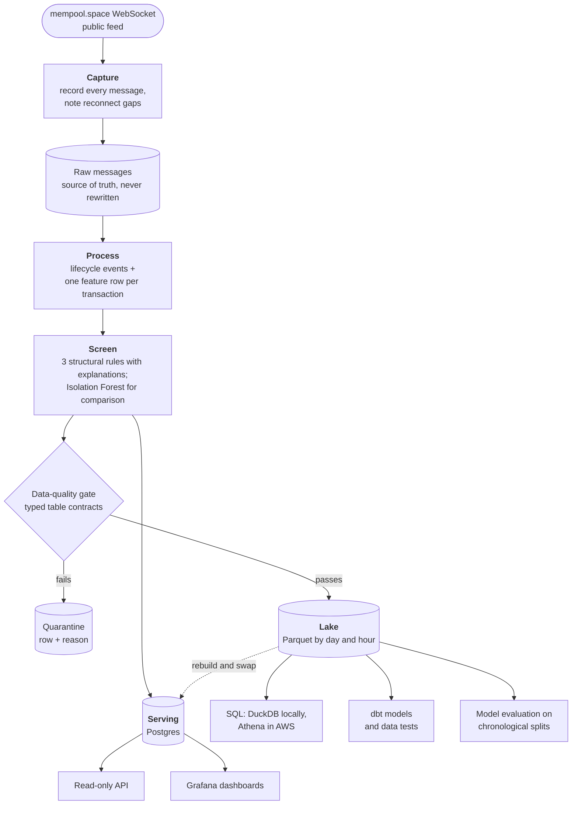
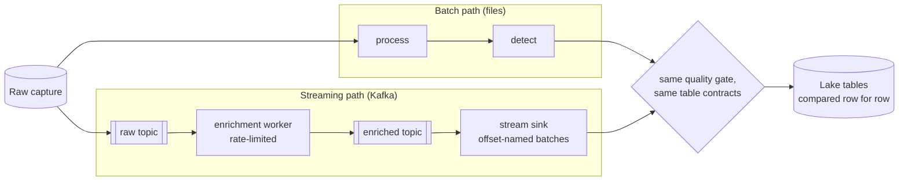
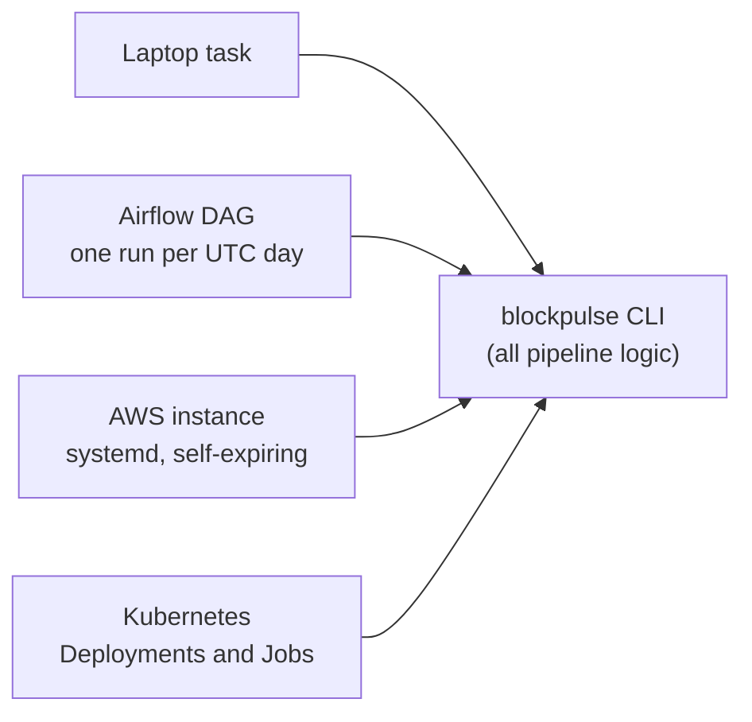
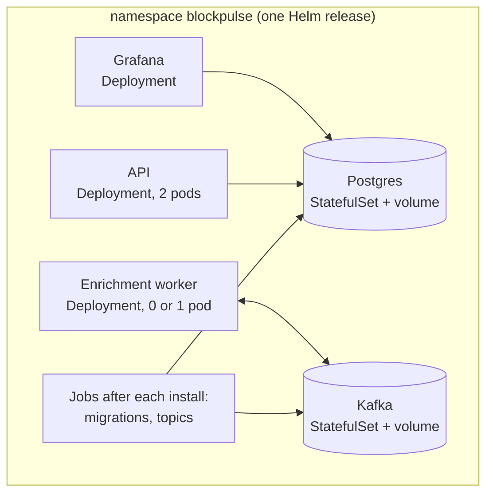

# BlockPulse

BlockPulse is a data pipeline for the Bitcoin mempool: the pool of transactions that have been broadcast to the network but are not yet in a block. It records the public mempool feed, turns each transaction into a row of features, screens those rows for unusual structure, and serves the results through SQL, an API and dashboards.

It was built to practise data engineering on a real, live, messy source. The screening gives the data a reason to flow; the engineering around it is the point: replayable ingestion, a data lake with quality checks, streaming and batch paths that agree, orchestration, infrastructure as code, and measured behaviour under load and failure.

> A flag means *unusual transaction structure*. It is not a fraud probability, a claim about intent, or evidence of wrongdoing. There are no labels, so no accuracy figure is claimed anywhere.

## What the pipeline does



Each stage in plain terms:

| Stage | What happens | Why it is built this way |
| --- | --- | --- |
| **Capture** | A WebSocket client records every message with a timestamp and sequence number. Reconnects and the gaps they leave are written down. | The feed cannot be re-requested. Keeping the raw bytes means every later stage can be rebuilt, and a missed window is recorded as missing instead of silently absent. |
| **Process** | Each message becomes lifecycle events and, for new transactions, a feature row: input and output counts, value, fee, size, fee rate, repeated output amounts, round amounts, replace-by-fee signalling. | One shared feature function is used by the batch path, the streaming path and the model, so there is one definition. A transaction with missing data is reported as an error, never filled with zeros. |
| **Screen** | Three transparent rules flag shapes: many outputs from few inputs, many inputs into few outputs, and repeated identical output amounts. Each flag states which counts crossed which threshold. | Rules are explainable and form a baseline. A model has to beat a recorded gate to replace them. |
| **Lake** | Rows pass typed table contracts. Rows that fail are quarantined with a reason; the rest are written as Parquet partitioned by date and hour. | The lake is the analytics store. Partitioning lets a query read only the hours it needs, and the contract is the single schema that also generates the AWS Glue catalog. |
| **Serving** | Postgres holds all transactions, scores and lifecycle events, loaded in bulk or rebuilt from the lake and swapped in. | Postgres is a serving copy for fast lookups, not the system of record. It can be thrown away and rebuilt in minutes. |

## Two paths, one result

The same data can travel two ways, and both must produce the same lake tables.

- **Batch.** Files in, files out: `capture` → `process` → `detect` → lake → Postgres. This is what unattended collection and the daily Airflow DAG run.
- **Streaming.** `capture-kafka` publishes to a Kafka topic, an enrichment worker fills in missing input values within a rate-limited request budget, and a stream sink writes the enriched topic into the same lake tables through the same quality gate, in small batches named by their Kafka offsets.



Kafka is a learning choice here: the volume does not need it. What it teaches is real, though. Delivery is *at-least-once* (after a crash, some messages are processed twice), so every sink is *idempotent* (writing the same message twice leaves one copy). That combination is what gives exactly-once results without distributed transactions.

## How it runs

One implementation, several runners. The pipeline logic lives in the `blockpulse` Python package and its CLI; the runners only decide when and where commands run.

| Runner | What it does | Guide |
| --- | --- | --- |
| The CLI | Every stage is a command; outputs go to new folders and never overwrite earlier runs | [01](docs/guides/01-capture-and-process.md) |
| Docker Compose | Kafka, Postgres, Grafana, Prometheus and Airflow as local services | [03](docs/guides/03-kafka.md), [04](docs/guides/04-postgres-api-dashboard.md) |
| Airflow | One DAG run per UTC day: screen, lake, load, `dbt build`, with retries and backfills | [13](docs/guides/13-airflow.md) |
| AWS (Terraform) | A locked-down EC2 instance that collects for a fixed time, uploads to S3 and powers itself off; Glue and Athena over the lake | [08](docs/guides/08-aws.md) |
| Kubernetes (k3d, Helm) | The serving stack as pods: Postgres and Kafka with persistent volumes, the API, the worker and Grafana | [14](docs/guides/14-kubernetes.md) |



On Kubernetes the serving stack looks like this. Each box is recreated by its controller if the pod is deleted, which is what the failure drills test.



## Design principles

- **Raw is the source of truth.** Everything downstream can be rebuilt from the recorded messages, and a replay is byte-identical.
- **Every stage can be run again safely.** Finished work is detected and skipped, loads recognise duplicates, and consumers resume from committed offsets. Retries and backfills are therefore routine.
- **One definition of each thing.** One feature function, one rule set, one lake schema, one SQL file that runs in both DuckDB and Athena, one collector for the laptop and the cloud.
- **Bad data is set aside, not repaired silently.** Rows that break the contract are quarantined with a reason and counted.
- **Every number has evidence.** Summaries, quality reports, checksummed manifests and dated experiment reports back each figure below.
- **Cloud resources are temporary.** Infrastructure is tested offline, deployed by the owner, and destroyed after the run.

## What the outputs mean

| Output | Meaning | What it does not mean |
| --- | --- | --- |
| A **rule flag** | The transaction's shape crossed a stated threshold, for example at most 2 inputs and at least 10 outputs | That anything is wrong. Exchanges batching payouts and wallets consolidating coins produce these shapes every day |
| A **model score** | How isolated the transaction is among those seen in training, by an Isolation Forest | A probability. With no labels there is no precision or recall |
| A **lifecycle status** | The strongest evidence seen for a transaction: observed unconfirmed, superseded (replaced), confirmed (mined), or removed for an unknown reason | The network's full view. This is one public provider's feed, and gaps are a lower bound |
| A **quarantined row** | A row that failed the lake contract, kept with its reason | Lost data. The raw message is still there |

Public blockchain data can be linked to people. Results describe patterns of transactions, never the owners of addresses.

## Results

Measured on recorded mempool traffic unless stated. Each row links to the guide that explains it; the dated reports are in [docs/experiments](docs/experiments/).

| Question | Result |
| --- | --- |
| Can the feed be collected unattended? | 89 hours on one AWS instance, 0 failures, 2.65 million transactions, about $0.80, then torn down ([08](docs/guides/08-aws.md)) |
| Is the data clean? | 8.5 million rows across 94 sessions passed the lake contract; 0 quarantined ([05](docs/guides/05-lake-and-athena.md)) |
| Is processing reproducible? | Replays are byte-identical; two recorded evaluation runs rebuild exactly ([06](docs/guides/06-ml-evaluation.md)) |
| Do the streaming and batch paths agree? | 13,707 messages streamed into the lake matched the batch lake row for row ([12](docs/guides/12-streaming-lake-and-metrics.md)) |
| Does a backfill equal a direct run? | A 3-day Airflow backfill matched with 0 differing rows in the lake, the dbt marts and Postgres ([13](docs/guides/13-airflow.md)) |
| How fast is it? | A day of traffic in 5.8 minutes in batch; streaming p50 latency 0.16 s after fixing a commit bottleneck ([09](docs/guides/09-load-test.md)) |
| How fast can serving be rebuilt? | 2.65 million transactions in 10.6 minutes; bulk loads 30 to 52 times faster than row by row, with identical contents ([04](docs/guides/04-postgres-api-dashboard.md)) |
| What happens when a component is killed mid-run? | Nothing is lost and nothing is double-counted, in Compose and as pod kills on Kubernetes ([10](docs/guides/10-failure-drills.md), [14](docs/guides/14-kubernetes.md)) |
| Does the model beat the rules? | No. The Isolation Forest fails 2 of 4 promotion criteria on 2.65 million rows, so the rules stay in charge ([06](docs/guides/06-ml-evaluation.md)) |

The Kubernetes drills use generated traffic (30,000 messages; 200,000 rows), because the recorded dataset is local and not in this repository. Each drill passed in two logged runs; their counts are never compared with the recorded ones.

The last row is a result, not a failure: the evaluation exists to decide honestly, and a model that flags 12.5% of ordinary large payments is not an improvement.

## Limits

- One Kafka broker, one Postgres, one node: the drills test correctness after a crash, not high availability.
- The streaming path writes features and rule flags to its own lake. Postgres can be rebuilt from it, but there is no continuous load, so serving is as fresh as the last rebuild.
- One public provider's view of the mempool, with recorded gaps.
- No labels, so no accuracy.

## Quick start

Python 3.11 or newer. Docker is needed only for the Kafka, Postgres, Airflow and Kubernetes parts. Commands are shown for Windows PowerShell, where the project is developed.

```powershell
python -m venv .venv
.\.venv\Scripts\python.exe -m pip install --require-hashes -r requirements.lock   # every dependency pinned and hashed
.\.venv\Scripts\python.exe -m pip install --no-deps -e .
.\.venv\Scripts\python.exe -m pytest -q
.\.venv\Scripts\python.exe -m blockpulse process examples/fixtures/mempool_messages.jsonl
```

The fixture is synthetic. To capture 60 seconds of the live feed and process it:

```powershell
.\.venv\Scripts\python.exe -m blockpulse capture --duration 60 --url wss://node203.sv1.mempool.space/api/v1/ws --output data/raw/my-capture
.\.venv\Scripts\python.exe -m blockpulse process data/raw/my-capture/messages.jsonl
```

The regional node is passed explicitly because the default host times out from some networks ([why](docs/experiments/2026-10-08-source-connectivity.md)). `python -m blockpulse --help` lists every command.

## Repository layout

| Path | Contents |
| --- | --- |
| `src/blockpulse/` | The pipeline: capture, processing, rules, Kafka workers, lake, serving, API, evaluation, drills |
| `analytics/` | Shared SQL queries and the dbt project |
| `orchestration/airflow/` | The Airflow image and the daily DAG |
| `infra/aws/` | Terraform for the collector, Glue and Athena; the instance's systemd units; offline tests |
| `infra/k8s/` | The k3d cluster definition, the BlockPulse image and the Helm chart |
| `observability/` | Grafana dashboards and Prometheus rules |
| `tests/` | pytest suite; CI also runs Terraform tests and container rehearsals |
| `docs/` | Architecture, guides, experiment reports, plan, learning path |

## Documentation

| Read | For |
| --- | --- |
| [Architecture](docs/ARCHITECTURE.md) | Components, data flow in detail, commands, modules, technology choices |
| [Plan and status](docs/PROJECT_PLAN.md) | What is done, what is next, the decisions and the risks |
| [Guides 01 to 14](docs/guides/) | How to run each part, and what was measured |
| [Experiments](docs/experiments/) | Dated reports and raw drill output behind every figure |
| [History](docs/archive/milestone-history.md) | How each milestone was completed |
| [Learning path](docs/learning/README.md) | Exercises that walk through the code, one concept at a time |

| Guide | Topic |
| --- | --- |
| [01](docs/guides/01-capture-and-process.md) | Capture and process |
| [02](docs/guides/02-structural-rules.md) | The structural rules and the review rubric |
| [03](docs/guides/03-kafka.md) | Kafka ingest, enrichment, replay |
| [04](docs/guides/04-postgres-api-dashboard.md) | Postgres, the API, Grafana |
| [05](docs/guides/05-lake-and-athena.md) | The lake, the quality gate, DuckDB and Athena |
| [06](docs/guides/06-ml-evaluation.md) | Model evaluation and the promotion gate |
| [07](docs/guides/07-collection.md) | Unattended collection |
| [08](docs/guides/08-aws.md) | AWS deployment, cost, teardown |
| [09](docs/guides/09-load-test.md) | Load tests |
| [10](docs/guides/10-failure-drills.md) | Failure drills |
| [11](docs/guides/11-dbt.md) | dbt models and tests |
| [12](docs/guides/12-streaming-lake-and-metrics.md) | Streaming into the lake; metrics and alerts |
| [13](docs/guides/13-airflow.md) | Airflow orchestration |
| [14](docs/guides/14-kubernetes.md) | Kubernetes and the pod-kill drills |

`CLAUDE.md` holds working conventions for AI-assisted sessions.
