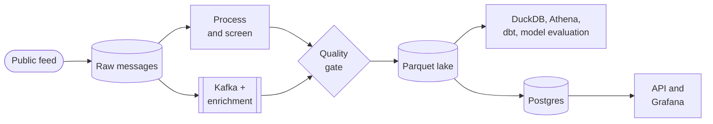
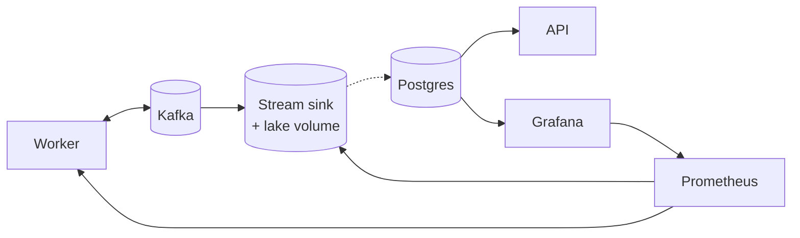
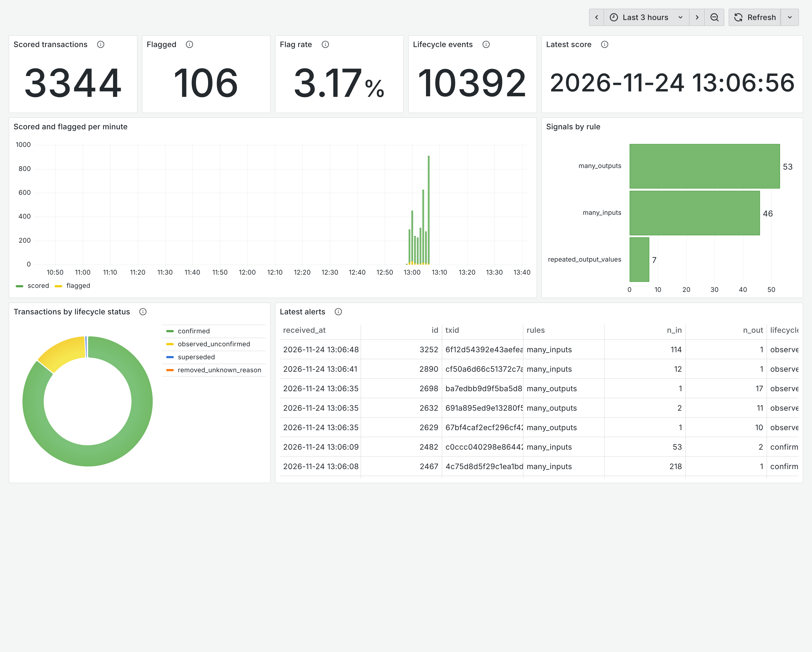
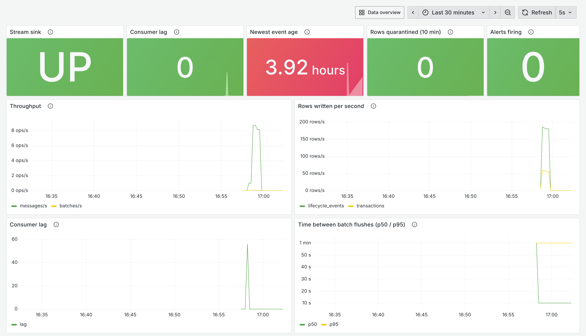
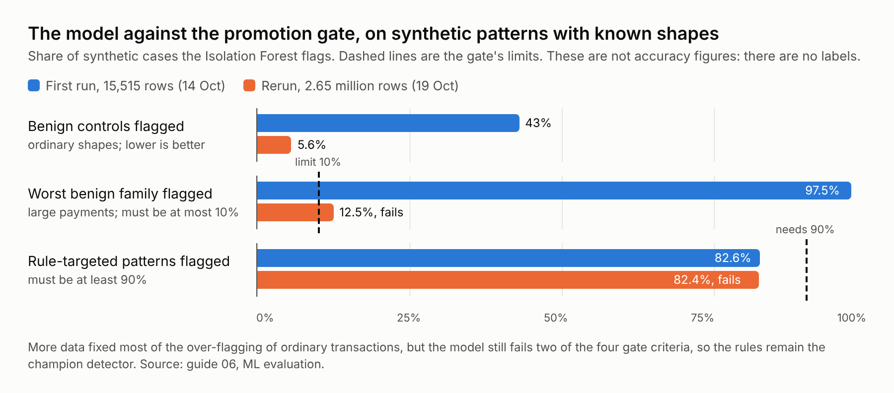

# BlockPulse

A data pipeline for the Bitcoin mempool, the pool of transactions that are broadcast but not yet in a block. It records the public feed, turns each transaction into a row of features, screens the rows for unusual structure, and serves the results through SQL, an API and dashboards.

It was built to practise data engineering on a live, messy source: replayable ingestion, a data lake with quality checks, streaming and batch paths that agree, orchestration, infrastructure as code, and measured behaviour under load and failure.

**Status: complete.** The roadmap is finished, the dataset is final, and CI is green. What was decided and why is in the [plan](docs/PROJECT_PLAN.md).

> A flag means *unusual transaction structure*. It is not a fraud probability or evidence of wrongdoing. There are no labels, so no accuracy figure is claimed.

## How it works



| Stage | What happens |
| --- | --- |
| **Capture** | Every WebSocket message is saved as received. Reconnect gaps are recorded, because the feed cannot be re-requested. |
| **Process** | Messages become lifecycle events (added, replaced, mined, removed) and one feature row per new transaction. Missing data is an error, never a zero. |
| **Screen** | Three transparent rules flag shapes (many outputs, many inputs, repeated output amounts) and say which threshold was crossed. An Isolation Forest is evaluated against them. |
| **Lake** | Rows pass typed table contracts and are written as Parquet partitioned by day and hour. Rows that fail are quarantined with a reason. |
| **Serve** | Postgres holds every transaction, score and event for the API and Grafana. It is a copy that can be rebuilt from the lake in minutes. |

Data reaches the lake two ways, and both must give the same tables. The **batch** path works on files (`capture`, `process`, `detect`). The **streaming** path goes through Kafka, a rate-limited enrichment worker and a sink that writes small batches named by their Kafka offsets. Delivery is at-least-once and every sink is idempotent, which gives exactly-once results without distributed transactions.

## Design principles

- **Raw is the source of truth.** Everything downstream can be rebuilt, and a replay is byte-identical.
- **Every stage can be run again safely**, so retries and backfills are routine.
- **One definition of each thing**: one feature function, one rule set, one lake schema, one SQL file for DuckDB and Athena.
- **Bad data is set aside, not repaired silently.**
- **Every number has evidence** in a dated report.

## How it runs

All logic is in the `blockpulse` Python package and its CLI. The runners only decide when and where commands run.

| Runner | What it does |
| --- | --- |
| CLI | Every stage is a command; outputs never overwrite earlier runs |
| Docker Compose | Kafka, Postgres, Grafana, Prometheus and Airflow locally |
| Airflow | One DAG run per UTC day, with retries and backfills |
| AWS (Terraform) | A locked-down instance that collects, uploads to S3 and powers itself off; Glue and Athena over the lake |
| Kubernetes (k3d, Helm) | Everything downstream of capture as pods, recreated by their controllers when killed |



## What it looks like

Two live captures of the public feed (ten minutes, 8,076 transactions) replayed through the Kubernetes deployment. Left: the data dashboard. Right: pipeline health; "newest event age" is red because the capture was replayed a few hours after it was recorded.

<p>
  
  
</p>

## Results

Measured on recorded mempool traffic unless stated. The dated reports are in [docs/experiments](docs/experiments/).

| Question | Result |
| --- | --- |
| Can the feed be collected unattended? | 89 hours on one AWS instance, 0 failures, 2.65 million transactions, about $0.80 ([08](docs/guides/08-aws.md)) |
| Is the data clean? | 8.5 million rows passed the lake contract; 0 quarantined ([05](docs/guides/05-lake-and-athena.md)) |
| Do the streaming and batch paths agree? | Row for row, including after compaction and in Postgres ([12](docs/guides/12-streaming-lake-and-metrics.md)) |
| Does a backfill equal a direct run? | A 3-day Airflow backfill matched with 0 differing rows ([13](docs/guides/13-airflow.md)) |
| How fast is it? | A day of traffic in 5.8 minutes in batch; streaming p50 latency 0.16 s ([09](docs/guides/09-load-test.md)) |
| How fast can serving be rebuilt? | 2.65 million transactions in 10.6 minutes ([04](docs/guides/04-postgres-api-dashboard.md)) |
| Would a stuck component be noticed? | The sink and the worker both expose lag and health; four alert rules cover down, behind, stale and quarantined ([12](docs/guides/12-streaming-lake-and-metrics.md)) |
| What if a component is killed mid-run? | Nothing lost, nothing double-counted, in Compose and as pod kills on Kubernetes ([10](docs/guides/10-failure-drills.md), [14](docs/guides/14-kubernetes.md)) |
| Does the model beat the rules? | No. It fails 2 of 4 promotion criteria, so the rules stay in charge ([06](docs/guides/06-ml-evaluation.md)) |

The Kubernetes drills use generated traffic, which is never compared with recorded counts.



## Limits

- One broker, one Postgres, one node: the drills test recovery after a crash, not high availability.
- One public provider's view of the mempool, with recorded gaps.
- No labels, so no accuracy.
- The dataset is final (2.65 million transactions); no further collection is planned.
- Postgres is rebuilt from the streamed lake on demand, not loaded continuously.

## Quick start

Python 3.11 or newer. Docker is needed only for Kafka, Postgres, Airflow and Kubernetes. Commands are for Windows PowerShell.

```powershell
python -m venv .venv
.\.venv\Scripts\python.exe -m pip install --require-hashes -r requirements.lock
.\.venv\Scripts\python.exe -m pip install --no-deps -e .
.\.venv\Scripts\python.exe -m pytest -q
.\.venv\Scripts\python.exe -m blockpulse process examples/fixtures/mempool_messages.jsonl
```

To capture 60 seconds of the live feed:

```powershell
.\.venv\Scripts\python.exe -m blockpulse capture --duration 60 --url wss://node203.sv1.mempool.space/api/v1/ws --output data/raw/my-capture
```

`python -m blockpulse --help` lists every command.

## Documentation

| Read | For |
| --- | --- |
| [Architecture](docs/ARCHITECTURE.md) | Components, data flow, commands, modules, technology |
| [Guides 01 to 14](docs/guides/) | How to run each part, and what was measured |
| [Plan and status](docs/PROJECT_PLAN.md) | Status, decisions, risks |
| [Experiments](docs/experiments/README.md) | Dated reports behind every figure |
| [Learning path](docs/learning/README.md) | 28 exercises through the code |
