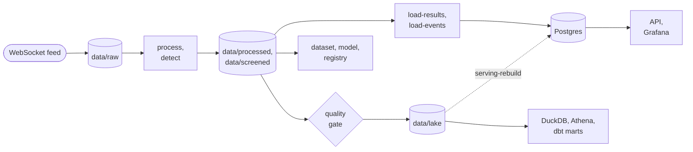
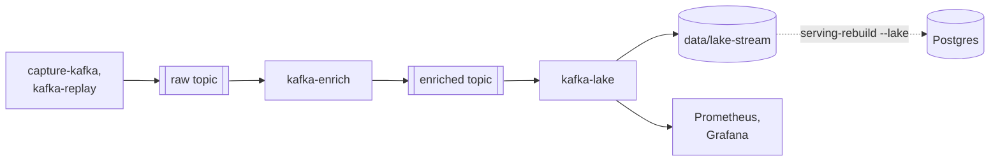
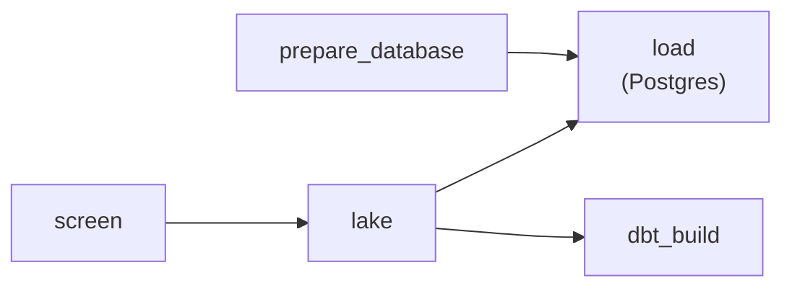
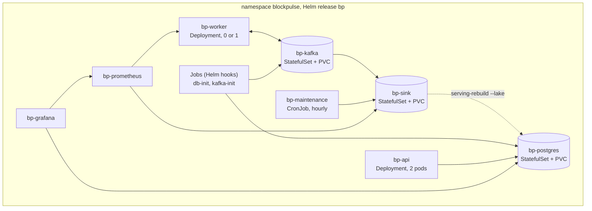

# Architecture

What is built, how the pieces connect, and where the code lives. The [README](../README.md) gives the short version and the results; for why, see the [plan](PROJECT_PLAN.md); for how to run each part, see the [guides](guides/). Last reviewed 2026-11-24, when the project was closed.

## Data flow

The streaming path starts from the same raw messages and ends in the same lake tables:

`kafka-enrich` also writes failures to an errors topic, and `lake-compact` merges the streamed lake's closed hours.

Unattended runs wrap the same steps: `collect-loop` captures hourly sessions, `process-pending` brings every finished session up to date (process, screen, lake, compact, log, optional Postgres load), `sync-pending` uploads to S3. On AWS these run as systemd services on one instance ([08](guides/08-aws.md)). Airflow runs the same commands as a DAG, one run per UTC day (`process-pending --date`), with retries and backfills ([13](guides/13-airflow.md)):

## Where it runs

The pipeline logic is the `blockpulse` package and its CLI. Four runtimes wrap it; none of them contains pipeline logic.

| Runtime | What runs there | Defined in |
| --- | --- | --- |
| A shell on the laptop | Any command by hand; the hourly collection task | `scripts/` |
| Docker Compose | Kafka (profile `m1`); Postgres, Grafana, Prometheus (`m2`); Airflow (`airflow`). Workers and the API run on the host and connect to these | `compose.yaml` |
| AWS | One EC2 instance running `collect-loop`, `process-pending` and `sync-pending` under systemd, with S3, Glue and Athena. Temporary: it powers off at a deadline | `infra/aws/` |
| Kubernetes (k3d) | Everything downstream of capture as pods in one namespace, from a Helm chart | `infra/k8s/` |

The Kubernetes layout, which mirrors the Compose services:

| Object | Runs | Notes |
| --- | --- | --- |
| `bp-postgres`, `bp-kafka`, `bp-sink` | StatefulSets, each with a volume | The only state in the cluster, plus Kafka's committed offsets |
| `bp-db-init`, `bp-kafka-init` | Jobs, after every install and upgrade | Migrations and topics; both apply only what is missing |
| `bp-api` | `blockpulse serve`, 2 pods | Reads the connection string from `Secret/bp-app` |
| `bp-worker` | `blockpulse kafka-enrich`, 0 or 1 pod | Off by default; creates the topics in an init container |
| `bp-maintenance` | `lake-compact`, hourly | Optionally `serving-rebuild --lake` afterwards |
| `bp-prometheus`, `bp-grafana` | Deployments | Scrape config, alert rules and dashboards from ConfigMaps |

One image, `blockpulse:dev`, runs the API, the worker, the sink and both Jobs with different arguments. State lives only in the three volumes and in Kafka's committed offsets, so any pod can be deleted and its controller recreates it. The streamed lake reaches Postgres through `serving-rebuild --lake`, run inside the sink's pod. Airflow is not in the chart; it runs under Compose.

## Design rules

The principles are stated in the [README](../README.md#design-principles). What they mean in the code:

- **Raw is the source of truth.** Finished captures are gzipped (`messages.jsonl.gz`, about 5x smaller); every reader opens either form through `storage.open_capture`.
- **The lake is the analytics store; Postgres is the serving copy.** `serving-rebuild` recreates the Postgres tables from the lake and swaps them in.
- **Every stage is idempotent.** Output folders are never overwritten; `process-pending` skips stages whose summary exists; loads rely on unique keys; consumers commit offsets after writing.
- **One implementation per concern.** `features.py`, `detector.py`, the contracts in `lake.py` (which also generate the Glue schema) and `collector.py` are each the only definition of their thing.
- **Runtimes mirror each other.** The Helm chart's defaults copy `compose.yaml`, so results can be compared.
- **Generated data is labelled.** `synth-capture` output carries `source_mode: synthetic`.

## Commands

`python -m blockpulse --help` lists them all.

| Group | Commands | Guide |
| --- | --- | --- |
| Capture and process | `capture`, `process`, `detect`, `lab`, `trace` | [01](guides/01-capture-and-process.md), [02](guides/02-structural-rules.md) |
| Kafka | `kafka-init`, `capture-kafka`, `kafka-replay`, `kafka-archive`, `kafka-enrich`, `kafka-parquet`, `kafka-lake` | [03](guides/03-kafka.md), [12](guides/12-streaming-lake-and-metrics.md) |
| Postgres and API | `db-init`, `load-results`, `load-events`, `serving-rebuild`, `serve` | [04](guides/04-postgres-api-dashboard.md) |
| Lake and SQL | `lake-query`, `lake-schema`, `lake-compact` (the lake itself is built by `process-pending` or `kafka-lake`) | [05](guides/05-lake-and-athena.md) |
| Modelling | `dbt build`, `dbt docs generate`, any dbt command (`blockpulse dbt ...`) | [11](guides/11-dbt.md) |
| ML evaluation | `build-dataset`, `verify-dataset`, `train-iforest`, `evaluate-iforest`, `sweep`, `detectors ...` | [06](guides/06-ml-evaluation.md) |
| Unattended collection | `collect`, `collect-loop`, `process-pending` (`--date` for one day), `sync-pending`, `compact-raw` | [07](guides/07-collection.md), [08](guides/08-aws.md) |
| Orchestration | Airflow DAG `blockpulse_daily` in the `airflow` Compose profile; `airflow backfill create` | [13](guides/13-airflow.md) |
| Kubernetes | `infra/k8s/cluster-up.sh`, `infra/k8s/image-load.sh`, `helm upgrade --install bp infra/k8s/chart/blockpulse` | [14](guides/14-kubernetes.md) |
| Load test and drills | `benchmark batch`, `benchmark streaming`, `drill enrich-crash`, `drill broker-restart`, `drill postgres-crash`; on Kubernetes `drill k8s-enrich-kill`, `drill k8s-broker-kill`, `drill k8s-postgres-kill`; `synth-capture` for generated traffic | [09](guides/09-load-test.md), [10](guides/10-failure-drills.md) |

## Code

Python package `src/blockpulse/` (about 6,400 lines, flat on purpose):

| Module | Lines | Role |
| --- | ---: | --- |
| `capture.py` | 198 | Bounded WebSocket capture, reconnects, gap records |
| `events.py` | 118 | One saved message to normalized lifecycle events |
| `features.py` | 66 | The shared feature function (`transaction-v2`) |
| `process.py` | 131 | Capture JSONL to events, features and an error report |
| `detector.py`, `detect.py`, `lab.py` | 330 | The three structural rules, offline screening, synthetic rule cases |
| `storage.py` | 56 | Never-overwrite run folders, atomic summaries |
| `kafka_pipeline.py`, `kafka_workers.py` | 606 | Topics, publisher, replay, archive consumer, enrichment consumer (batched checkpoints) |
| `stream_lake.py` | 263 | Enriched topic to lake tables in offset-named micro-batches, through the quality gate, with bounded duplicate memory (`kafka-lake`) |
| `lake_compact.py` | 80 | Merge the streamed lake's small files, one per closed hour (`lake-compact`) |
| `metrics.py` | 98 | Prometheus metrics for the stream sink and the enrichment worker: lag, freshness, throughput, quarantines, requests |
| `enrichment.py`, `parquet_archive.py` | 370 | Rate-limited REST enrichment; Kafka-to-Parquet archive |
| `db.py`, `results.py`, `lifecycle.py` + `migrations/` | 303 | Postgres migrations; bulk (`COPY` + set-based merge) duplicate-safe loads; lifecycle status projection |
| `warehouse.py` | 46 | Runs the dbt project with absolute paths (`dbt`) |
| `serving.py` | 196 | Rebuild the serving tables from the batch or the streamed lake and swap them in atomically (`serving-rebuild`) |
| `api.py`, `trace.py` | 238 | Read-only FastAPI; one transaction traced back to its raw message |
| `lake.py`, `analytics.py` | 356 | Lake contracts, quality gate, partitioned writer, Glue schema export; DuckDB views |
| `dataset.py` | 320 | Checksummed chronological manifests, lake- or JSONL-backed split loading |
| `model.py`, `evaluate.py`, `sweep.py`, `registry.py` | 719 | Isolation Forest, threshold calibration, synthetic sweep, detector registry and gate |
| `collector.py` | 359 | Capture loop, idempotent session processing (all pending, or one start date), lock, S3 upload |
| `benchmark.py` | 198 | Batch and streaming load tests on recorded sessions (`benchmark`) |
| `drills.py` | 201 | Failure drills: worker crash, broker restart, Postgres crash (`drill`) |
| `k8s_drills.py` | 316 | The same drills as pod kills in a k3d cluster (`drill k8s-*`) |
| `synth.py` | 66 | Deterministic synthetic capture sessions for drills (`synth-capture`) |
| `cli.py` | 628 | Command-line entry point |

Elsewhere:

| Path | What it is |
| --- | --- |
| `tests/` | pytest (197 tests); Postgres tests opt in with `BLOCKPULSE_TEST_DSN`; Helm chart tests need `helm`; the Kubernetes drill logic is tested with `kubectl` faked |
| `analytics/queries/` | Shared SQL, run by DuckDB locally and saved as Athena named queries |
| `analytics/dbt/` | dbt project: staging, intermediate and mart models with tests, over the lake |
| `orchestration/airflow/` | Airflow image (BlockPulse in its own venv) and the `blockpulse_daily` DAG |
| `infra/aws/terraform/` | The AWS collector stack (VPC, instance, S3, IAM, Glue, Athena, budget) and its mocked-provider tests |
| `infra/aws/instance/` | `install.sh`, `deadline-check.sh` and the hardened systemd units that run on the instance |
| `infra/aws/tests/` | Amazon Linux 2023 container rehearsals: bootstrap smoke test and real systemd end to end |
| `infra/aws/build_bundle.py` | Reproducible app zip for the instance |
| `observability/grafana/` | Provisioned datasources (Postgres, Prometheus) and dashboards (data, pipeline health) |
| `observability/prometheus/` | Scrape config and alert rules |
| `compose.yaml` | Profiles `m1` (Kafka), `m2` (Postgres, Grafana, Prometheus) and `airflow` |
| `infra/k8s/` | k3d cluster definition and creation script; the BlockPulse image (`Dockerfile`, `image-load.sh`); Helm chart `chart/blockpulse/` with Postgres and Kafka StatefulSets, setup Jobs, API, worker and Grafana ([14](guides/14-kubernetes.md)) |
| `scripts/` | Laptop collection task, M2 demo, M3 reproduction |
| `examples/` | Learning exercise 1 and synthetic fixtures |
| `.github/workflows/ci.yml` | CI: lock check, lint, pytest with Postgres, Terraform checks, shellcheck, container rehearsals, and a k3d cluster with a chart install and one pod-kill drill |

## Technology

| Concern | Choice | Notes |
| --- | --- | --- |
| Language | Python 3.11+ | websockets, confluent-kafka, pyarrow, duckdb, psycopg, FastAPI, scikit-learn |
| Streaming | Apache Kafka 4.3 (KRaft, one broker) | Topics `blockpulse.raw.v1`, `.enriched.v1`, `.errors.v1`; 3 partitions; keyed by capture session |
| Raw and replay | JSONL | Inspectable; byte-identical replay |
| Lake | Parquet + Zstandard, Hive partitions `dt`/`hour` | One file per session per partition |
| SQL | DuckDB locally, Athena in AWS | Same queries; Glue partition projection; 1 GiB scan cap |
| Modelling | dbt-core 1.12 with dbt-duckdb | Marts and data tests over the lake |
| Serving | PostgreSQL 17, FastAPI, Grafana 12 | Read-only API |
| Orchestration | Apache Airflow 3.3 (standalone, LocalExecutor, SQLite metadata) | Tasks call the `blockpulse` CLI from a separate venv; a one-slot pool guards the data root |
| Kubernetes | k3d (k3s 1.31) and Helm 3 | Kafka, worker, sink, Postgres, API, Prometheus and Grafana as StatefulSets, Deployments and Jobs; defaults mirror `compose.yaml` |
| Metrics | Prometheus 3.5, prometheus-client | Scrapes the stream sink every 5 s; alert rules for lag, freshness, quarantine, sink down |
| ML | scikit-learn Isolation Forest | Local append-only registry instead of MLflow |
| Infrastructure | Terraform (AWS provider 6.x), systemd on Amazon Linux 2023 | No inbound ports, Session Manager, self-expiring |

## Known limits

- One Kafka broker and one instance: nothing is highly available. The Kubernetes cluster has one node, so it shows self-healing of pods, not survival of a node.
- Scoring is offline (files in, files out); no streaming feature or score worker.
- The streamed lake reaches Postgres only through a full `serving-rebuild --lake`, not a continuous load, and it is a separate lake (`data/lake-stream`) from the batch one.
- The stream sink makes small files (one per partition per 5-second batch) until `lake-compact` merges each closed hour.
- Postgres is a serving copy on one 512 MB container. Incremental loads slow down as the random-keyed `lifecycle_events` index outgrows memory, so large backfills use `serving-rebuild` ([04](guides/04-postgres-api-dashboard.md#two-ways-data-gets-in)).
- The Kafka-to-Parquet archive writes one file per message (built for restart clarity); the lake is the right-sized store.
- The Helm chart does not include Airflow. Compaction is scheduled in the cluster (a CronJob) but not under Compose, where it is run by hand.
- Kubernetes has run only on generated traffic: in a cloud session, and in CI, which creates a cluster and runs one pod-kill drill on every push.
- The dataset is final (2.65 million transactions; decision D32). Results on it will not be extended by further collection.
- `cli.py` dispatches every command from one long function. It works and is tested, but it is the first thing to restructure if commands keep being added.
- A design review on 2026-11-24 fixed two weaknesses in place and recorded why the others stay ([report](experiments/2026-11-24-design-review.md)).
