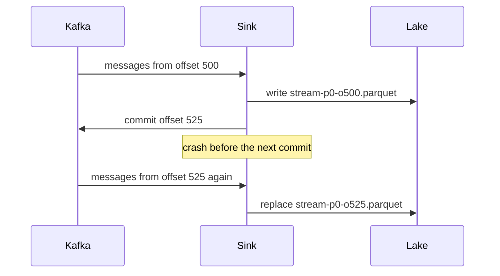
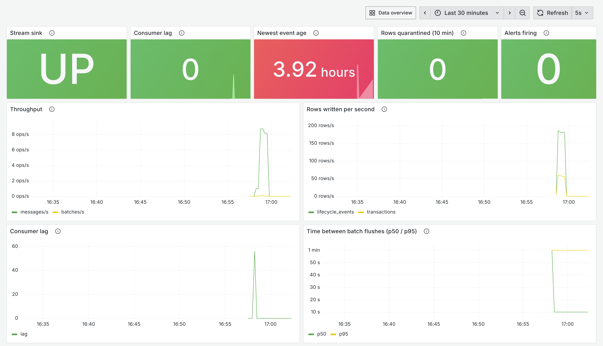
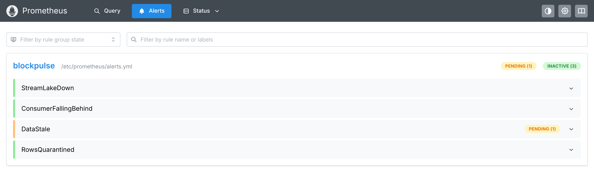

# 12 · Streaming into the lake, with metrics

Until DE5 the lake was built only from files: `process-pending` read finished captures, and the Kafka path ended in archives. `kafka-lake` closes that gap. It consumes the enriched topic, computes the same features and rules in the stream, and writes the same lake tables through the same quality gate. Prometheus scrapes its metrics and Grafana charts them.

```powershell
docker compose --profile m1 up -d --wait          # Kafka
docker compose --profile m2 up -d --wait          # Postgres, Grafana, Prometheus (127.0.0.1:9090)
.\.venv\Scripts\python.exe -m blockpulse kafka-lake --group-id lake-1 --metrics-port 9108
```

By default it writes to `data/lake-stream`, kept apart from the batch lake (`data/lake`) so the two can be compared. It stops after 10 s with no new messages (`--idle-timeout`). Restart it with the same `--group-id` and it resumes where it stopped.

## How it works (`stream_lake.py`)

```text
blockpulse.enriched.v1 --> rows_from_enriched --> per-partition micro-batch --> quality gate --> lake files --> commit offset
                           (features + rules)     (500 msgs or 5 s)            (lake.validate)   + _quality/ report
```

- **Same logic as the batch path.** `extract_features` and `screen_transaction` are the shared functions, and the contract is `lake.TABLES`. Nothing is redefined for the stream.
- **Micro-batches.** A batch covers one Kafka partition's contiguous offsets and closes after 500 messages or 5 seconds. Its files are named `stream-p{partition}-o{first offset}`, so a replay of the same offsets produces the same names.
- **Exactly-once output on at-least-once delivery.** Offsets are committed only after the files and the quality report are written. If the process dies in between, the batch is read again. Before writing, the sink deletes every earlier file of that partition whose batch started inside the new batch's offset range. That matters because batches also close on a timer, so a replay can cut the same offsets differently. A test covers exactly that case.
- **Group changes.** If a commit fails because the group rebalanced (for example after a broker restart), the sink logs it and carries on. The batch is redelivered and overwrites the same files.

What it doesn't do:

- `capture_sessions` coverage comes from capture summaries, which aren't in Kafka, so the stream writes only `transactions` and `lifecycle_events`.
- The `session` column holds the run id, because the stream doesn't know capture folder names.
- "First observation of a txid per run wins" is kept in memory, so a restart in the middle of a run could write a second row for a transaction that is announced again later in that run. `fct_transactions` in dbt keeps the first observation either way.

The order of operations is what makes a crash harmless. Offsets are committed only after the files exist, and a batch's files are named after its first offset, so a batch that is read twice replaces its own files:



## Metrics (`metrics.py`)

| Question | Metric | Type |
| --- | --- | --- |
| Is it keeping up? | `blockpulse_consumer_lag_messages` | Gauge, updated after each batch |
| Is the data fresh? | `blockpulse_newest_event_age_seconds` (now minus the newest `received_at` seen) | Gauge, computed at scrape time |
| Is bad data arriving? | `blockpulse_rows_quarantined_total{table}` | Counter |
| How fast is it going? | `blockpulse_messages_consumed_total`, `blockpulse_rows_written_total{table}`, `blockpulse_batches_total`, `blockpulse_batch_seconds` | Counters, histogram |

The only label is the table name. Transaction ids or error strings never become labels, because every distinct label value creates a new time series (that is the *cardinality* problem).

Prometheus (`observability/prometheus/prometheus.yml`) scrapes `host.docker.internal:9108` every 5 s, because the sink runs on the host and Prometheus runs in Compose. The Grafana dashboard **BlockPulse pipeline health** shows whether the sink is up, lag, freshness, quarantined rows, throughput, rows per second by table, and batch-flush time (p50/p95).



*The pipeline dashboard in the Kubernetes deployment after two live captures were replayed. Newest event age is red because the replay happened about half an hour after the capture.*

### Alert rules (`observability/prometheus/alerts.yml`)

| Alert | Condition | For |
| --- | --- | --- |
| `StreamLakeDown` | `up == 0` | 1 min |
| `ConsumerFallingBehind` | lag > 1,000 messages | 2 min |
| `DataStale` | newest event older than 10 min | 5 min |
| `RowsQuarantined` | any quarantined row in the last 10 min | immediately |

The `for` clause is what keeps an alert from paging on a blip. A rule whose condition is true sits in *pending* and only *fires* if the condition stays true for the whole window. `promtool check rules` validates the file.



*The four rules in Prometheus during that replay. `DataStale` is pending, not firing: the condition is true but has not yet held for the rule's `for` window.*

## Results (2026-10-20, 6 recorded sessions replayed through Kafka)

| Check | Result |
| --- | --- |
| Messages streamed | 13,707, 48 micro-batches, 157.5 s end to end (including the 10 s idle wait) |
| Rows written | 207,913 transactions, 466,920 lifecycle events, 0 quarantined |
| Stream lake against batch lake, same sessions | Row-for-row identical in both tables (`EXCEPT ALL` both ways returns 0 rows, after mapping session folder to run id) |
| Prometheus | Target up; lag peaked at 13,548 and drained to 0; every dashboard panel returns data |
| `ConsumerFallingBehind` | Pending, never fired: lag was above 1,000 for about 115 s, under the 2-minute window. That is the intended behaviour for a replay that catches up |
| `DataStale` | Pending: the replayed events are days old. It would fire after 5 minutes, which is correct for old data |

Tests (`tests/test_stream_lake.py`, `tests/test_metrics.py`):

- The streamed lake equals the batch lake on fixture captures.
- A crash after writing but before committing replays without duplicates.
- A replay with different batch boundaries leaves no stale rows.
- The metrics count rows, quarantines and freshness, both directly and when the sink drives them.

## Compaction (`lake_compact.py`)

The sink writes one file per Kafka partition per micro-batch, so an hour of traffic becomes hundreds of small files. Query engines pay per file: a listing, a footer read, and in Athena a minimum charge. *Compaction* rewrites a partition directory as one sorted file holding the same rows.

```powershell
.\.venv\Scripts\python.exe -m blockpulse lake-compact --lake data/lake-stream                    # every closed hour
.\.venv\Scripts\python.exe -m blockpulse lake-compact --lake data/lake-stream --include-latest   # only when no sink is running
```

- **Only closed hours.** The newest hour in each table is skipped: the sink may still write to it, and a replay after a crash replaces files there by name, which a merged file would hide.
- **Safe to interrupt and repeat.** The merged file is written under a temporary name and renamed before the inputs are deleted. If a run dies in between, the hour briefly holds both; the next run merges them and drops the exact duplicate rows. A second run on a compacted lake does nothing.
- **Rows are not changed.** The quality gate already ran when they were written.

## Serving the streamed lake

`serving-rebuild --lake data/lake-stream` rebuilds the Postgres serving tables from the stream sink's lake instead of the batch lake, so the API and Grafana show what was streamed ([04](04-postgres-api-dashboard.md#two-ways-data-gets-in)). The streamed lake is taken as the whole truth for that rebuild: the stream names a capture by its run id and the batch path by folder name, so mixing the two would count captures twice.

Both are covered by tests (`tests/test_lake_compact.py`, `tests/test_serving.py`) and were checked on recorded traffic on 2026-11-24: for two live captures (503 messages, 3,344 scored transactions, 10,392 events) the streamed lake equalled the batch lake row for row before and after compaction, and Postgres rebuilt from the compacted streamed lake had the same row checksums as Postgres rebuilt from the batch lake ([report](../experiments/2026-11-24-live-capture-and-stream-path.md)). The runs are too small to time.

## Limits

- Compaction is scheduled only in the Kubernetes deployment (an hourly CronJob, [14](14-kubernetes.md)); under Compose it is a command you run.
- Serving from the streamed lake is a full rebuild, not a continuous load, so Postgres is as fresh as the last rebuild.
- Under Compose the sink is one consumer run by hand; Airflow schedules batch jobs, not long-running consumers ([13](13-airflow.md)). In the Kubernetes deployment it is a StatefulSet that is restarted if it stops ([14](14-kubernetes.md)).
- Freshness is measured from the newest event the sink has *seen*, so it can't tell "the feed stopped" from "the sink stopped". `StreamLakeDown` covers the second case.
